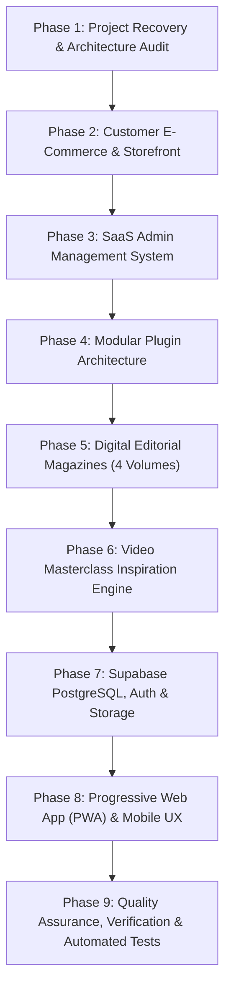

# HomeHub — Master Project Architecture & Implementation Plan
**Brand:** HOMEHUB (SHOP • STYLE • SMART)  
**Palette:** Soft Ivory (`#F8F5EF`), Sage Mist (`#DDE8DF`), Warm Beige (`#EADCCB`), Dusty Blush (`#E9D8D0`), Soft Champagne (`#D6BC91`), Charcoal (`#1B1917`)  
**Currency:** PKR (Pakistani Rupee)  
**Architecture:** Modern Modular Web Application (Vanilla ES6 Modules, No WordPress, No WooCommerce), Node.js Zero-Dependency API Server, Supabase PostgreSQL/Auth/Storage Backend, and Full PWA.

---

## 1. Executive Vision & Core Standards
HomeHub is an ultra-premium, mobile-first interior inspiration and e-commerce platform combining:
1. **Interactive 3D Digital Magazines:** 4 authentic editions (*The Living Edit*, *Objects of Home*, *Light / Life*, *Small Spaces*) with double-page spreads and clickable product hotspots.
2. **Curated Room Makeover Video Masterclasses:** 5 high-definition design masterclasses with architectural takeaways and direct "Shop the Look" piece trays.
3. **Full Customer Commerce Experience:** 9 Room Categories, 14 authentic furniture pieces with multi-angle galleries, dimensions, materials, care guides, and PKR pricing.
4. **Frictionless Shopping & Checkout:** Persistent bag, wishlist with move-to-bag, Pakistani metropolitan delivery quick-selectors, guest and authenticated checkout, and printable/downloadable PDF receipts.
5. **Separate SaaS Admin Management System:** Comprehensive business management portal with revenue analytics charts, full product CRUD with image uploads, category manager, inventory tracker, order fulfillment manager, customer directory, coupon engine, content CMS, and store settings.
6. **Modular Plugin Architecture:** 15 decoupled, independently maintainable modules with an internal feature registry.
7. **Production PWA:** Installable mobile experience with Web App Manifest, Service Worker caching, and offline support.

---

## 2. Nine-Phase Implementation Roadmap

### Detailed Phase Specifications

### Phase 1 — Project Recovery & Architecture Audit
- Verify project directory integrity at `C:\Users\zuni\Desktop\webstore`.
- Audit existing modules, styles, dependencies, server endpoints, and tests.
- Maintain persistent tracking documents (`HOMEHUB_TASK_TRACKER.md`, `HOMEHUB_CHANGELOG.md`, `HOMEHUB_TEST_REPORT.md`, `HOMEHUB_KNOWN_ISSUES.md`).

### Phase 2 — Customer E-Commerce Storefront
- **Storefront:** Minimal luxury homepage, 9 category destinations, live search with autocomplete suggestions, filters, price/alphabetical sorting, and equal 6-column desktop / 3-column tablet / 2-column mobile grids.
- **Product Detail:** Multi-angle photography, dimensions, materials, care guides, color finish swatches, quantity stepper, PKR pricing, and related pieces.
- **Shopping Bag & Wishlist:** Persistent local storage, real-time subtotal calculation, complimentary white-glove delivery rule, and move-to-bag operations.
- **Coupons & Checkout:** Coupon code engine (percentage & fixed PKR discounts), guest checkout, Pakistan city pre-selectors, and order validation.
- **Order Tracking & Receipts:** Unique order number generator, white-glove delivery tracking, and printable/downloadable vector PDF invoices.

### Phase 3 — Comprehensive SaaS Admin Portal
- **Dashboard:** Metric cards (Gross Revenue, Orders Count, Active Products, Low Stock Count), interactive revenue & sales trend charts, and recent activity log.
- **Product CRUD:** Add, edit, toggle active status, delete products, multi-format image upload (`.jfif`, `.webp`, `.jpg`, `.png`, etc.), and bulk stock updates.
- **Category Manager:** Manage 9 room categories, styling principles, and before/after inspiration studies.
- **Inventory Engine:** Stock adjustments, low-stock threshold triggers (<= 2 units), and stock history.
- **Order Fulfillment:** Live status pipeline (`PENDING`, `CONFIRMED`, `SHIPPED`, `DELIVERED`, `CANCELLED`), delivery destination updates, and receipt printing.
- **Customer Directory:** Customer list, contact information, total spend, and order history.
- **Coupons Management:** Create coupons, set discount values, expiration dates, and usage limits.
- **Store Settings:** Branding, logo, currency format, contact founder line, and delivery policies.
- **Role-Based Security:** Multi-role access control (`SUPER_ADMIN`, `STORE_MANAGER`, `PRODUCT_MANAGER`, `ORDER_MANAGER`, `STUDIO_EDITOR`).

### Phase 4 — Modular Plugin-Style Architecture
- Decoupled modules: `commerce`, `catalogue`, `inventory`, `orders`, `customers`, `shipping`, `coupons`, `reviews`, `wishlist`, `analytics`, `seo`, `magazineCMS`, `videoCMS`, `invoices`, `settings`.
- Central `PluginRegistry` to register, inspect, and toggle features without altering core code.

### Phase 5 — Editorial Digital Magazines (4 Volumes)
- Full spread fidelity for *The Living Edit*, *Objects of Home*, *Light / Life*, and *Small Spaces*.
- Smooth 3D flipbook animation, realistic paper curvature, double-page continuous spreads, table of contents, and tap-to-inspect product hotspots.

### Phase 6 — Interior Design Video Masterclasses
- Curated video suite with responsive player, play/pause controls, buffering/error states, timestamped design takeaways, and direct product trays.

### Phase 7 — Supabase Backend & Hybrid Cloud Storage
- PostgreSQL database setup in `supabase/HOMEHUB_DATABASE_SETUP.sql`.
- Row-Level Security (RLS) enforcement.
- RPC function `create_homehub_order()` for server-validated order placement.
- Dual storage architecture: Direct Supabase Storage (`product-images`) with automatic zero-failure fallback to local server storage (`/assets/uploads/`).

### Phase 8 — Progressive Web App (PWA)
- `manifest.json` configured with luxury palette theme colors, standalone display, and standard icons.
- Service Worker `sw.js` with asset caching, offline fallback, and mobile touch navigation.

### Phase 9 — Quality Control & Verification
- Comprehensive automated test runner verifying syntax, E2E user flows, Supabase integration, PWA compliance, and admin permissions.
